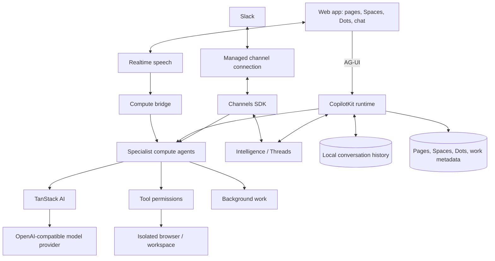

<div align="center">

# Solana Dots

The macOS desktop app, side drawers, secure provider setup, and mobile browser pairing are documented in [Solana Dots for Mac](docs/SOLANA-DOTS-DESKTOP.md). Run `npm run desktop:dev` locally or `npm run desktop:package` to build the signed Apple Silicon release.

ChatGPTEE lives at [chatgptee.ai](https://chatgptee.ai). Sign in with a Solana wallet to open your own workspace. [Authentication and deployment](docs/AUTHENTICATION.md) describes Privy, Supabase PostgreSQL, and persistent user storage.

Open **Pump.fun**, **Jupiter**, or **Wallets & assets** in the sidebar for live launch discovery, connected-wallet transaction reviews, and DFlow/Jupiter quote cards. Jupiter offers managed swaps and advanced builds with fast routing, slippage and account-count controls. Each transaction requires approval in your wallet. See [Solana workspace](docs/SOLANA-WORKSPACE.md).

Open **Solana workspace → Trading brain** for natural-language Pump.fun strategies, private Supermemory graph recall, TypeSafe decisions, and opt-in monitoring. The journal survives restarts, outcome observations can raise the review threshold, and trades use the existing wallet approval cards. See [Trading intelligence](docs/TRADING-BRAIN.md).

Open **OpenMarket** in the sidebar or Solana workspace for crypto charts, cross-exchange volume, 1,000-level orderbooks, Hyperliquid heatmaps and Polymarket analytics. Dots can research the same data through the read-only `openmarket_data` tool. Configure the server-only `OPENMARKET_API_KEY`; dataset permissions and quota errors are shown explicitly. See [OpenMarket setup](docs/OPENMARKET.md).

Configure the server-only `BIRDEYE_API_KEY` for Birdeye token, wallet and market research. Permitted Dots discover official Beta MCP schemas with `birdeye_mcp_catalog`, call discovered read-only tools with `birdeye_mcp_call`, and read exact mint details with `birdeye_meme_detail`. The connection uses `https://mcp.birdeye.so/mcp`; provider access and shared credits remain visible. Native Mac users can save the key in encrypted **Provider connections → Birdeye** settings. See [official MCP setup and task catalog](docs/BIRDEYE-MCP.md) and the [Birdeye research workspace](docs/BIRDEYE.md).


### Your agents. Your workspace. Your Solana identity.

**An open-source template for persistent AI agents, each with its own computer. Available on Web and Mobile.**

A Solana-branded adaptation of [OpenDots](https://github.com/CopilotKit/OpenDots), built with [CopilotKit](https://github.com/CopilotKit/CopilotKit) and [AG-UI](https://docs.ag-ui.com/introduction). · [Get started](#get-started) · [Overview](#overview) · [Architecture](#architecture) · [Features](#features) · [Contributing](CONTRIBUTING.md)

[](https://github.com/CopilotKit/OpenDots/actions/workflows/ci.yml)
[](./LICENSE)


<a href="https://trendshift.io/repositories/275323" target="_blank"></a>

Host ChatGPTEE on your own infrastructure. Conversations use local SQLite storage with your configured model. Optionally connect CopilotKit Intelligence for cloud Threads, learning, and Slack through the hosted service, the [local Docker evaluation](docs/SETUP.md#local-intelligence-evaluation), or a licensed [self-hosted deployment](https://docs.copilotkit.ai/intelligence/self-hosting).

[**Building on ChatGPTEE? Meet with the CopilotKit team →**](https://www.copilotkit.ai/talk-to-an-engineer?ref=opendots_readme)

</div>

---

<div align="center">

<table><tr><td>

https://github.com/user-attachments/assets/4c74fe7d-ecdd-42dd-95da-5d34f9b9576e

</td></tr></table>

</div>

_Ask → browse → approve → save. A live computer view and a human review card appear right in chat, then the approved draft becomes an editable Space page. Enlarged for readability; idle time is trimmed and playback is accelerated._

## Overview

ChatGPTEE is a starting point for building your own agent workspace. Clone it, define your Dots, connect your services, and adapt the interface and tools to your needs.

**A template, not a hosted product.** You run the application and configure its infrastructure. The template is in early development; the Features section below describes what's included and distinguishes local verification from connected-service testing.

### Spaces

A Space is a home for working documents. Dots appear separately in navigation and can be granted access to multiple Spaces in their settings. Each Dot has a default destination for saved pages; existing installations retain their original Space access. Browse pages in a searchable library, switch between grid and list views, and organize documents as nested subpages. Open a page in a focused visual editor with formatting, slash commands, and undo/redo. Write directly, save a conversation as a page, or ask a specialist to create and revise content.

Pages stay in the local workspace database. Each page and specialist has a separate conversation, stored locally or in the configured CopilotKit Intelligence project. Page links connect the document workspace to Dot chat. Manual editing works before you configure a model. Autosave reports its progress, failed saves retain your draft, and revision checks prevent stale edits from overwriting newer content. Markdown source mode remains available.

<div align="center">

<table><tr><td>

https://github.com/user-attachments/assets/d20c3405-4339-49e7-a799-43298728015c

</td></tr></table>

</div>

_Open a Space, navigate to its launch brief, ask Scout about the saved page, and continue in Dot chat. This recording uses live page chat and example launch content._

### Specialist Dots

Give each Dot a name, role, instructions, and permitted tools. A researcher can investigate a topic; a writer can turn findings into a draft. Inspect their work and control what they can do.

### Dot computers

Each Dot can have its own E2B desktop. Its browser profile and workspace files persist across pause/resume. The Computer panel exposes browser control, human takeover, files, terminal output, and activity, with browser, file, and shell permissions set per Dot. The application keeps service credentials on the server and authenticates sandbox ports.

Set `E2B_API_KEY` and follow [Dot integrations](docs/DOT-INTEGRATIONS.md#e2b-desktop). The original [OpenBot](https://github.com/CopilotKit/OpenBot) alternative remains available with `COMPUTER_PROVIDER=openbot`; see [Computer setup](docs/COMPUTERS.md) to build its pinned services.

The Computer panel also includes [Browser Use Cloud](docs/BROWSER-USE.md), using server-side `BROWSERUSE_API_KEY`, `CLAWD_PROFILE`, and optional `CDP_URL`. It supports recorded browser sessions, tasks driven by xAI `grok-4.7` with `XAI_API_KEY` by default (`BROWSER_USE_LLM_PROVIDER=browser-use` switches to the hosted `BROWSER_USE_MODEL`, default `gpt-6-luna`), follow-ups, and explicit session stopping.

<div align="center">

<table><tr><td>

https://github.com/user-attachments/assets/30b691c3-0f66-4964-9fdb-67d4feab5568

</td></tr></table>

</div>

_Ask Scout to open a website, summarize it, save notes, and verify the file. Every computer action in this demo is requested through chat; CopilotKit tool renderers show the live browser, saved file, and terminal output inline._

### Review before saving

Ask a Dot to show a draft before saving it. A CopilotKit human-in-the-loop card pauses the conversation for **Approve & save** or **Decline**. Approval creates the page in an authorized Space and returns a link; retries with the same draft recover that saved page. A changed draft needs a new review. The agent continues after your decision.

### Connections

Give a Dot tools from any MCP server, such as email, calendar, GitHub, or your own services. Read-only tools run on their own. Any other tool pauses for an **Approve & run** card in chat, and only your approval runs it. You can turn each tool on or off per Dot. See [Connections](docs/CONNECTIONS.md).

Choose **Connect Supermemory** for OAuth access to `https://mcp.supermemory.ai/mcp`, with native space selection and per-Dot tool controls. The separate server-only `SUPERMEMORY_API_KEY` powers the private trading-memory outbox, including when TypeSafe is unavailable. See [Supermemory](docs/SUPERMEMORY.md).

### Text and calls

A continuous conversation keeps the Dot's avatar and status above the messages, with text and call controls close at hand. Work updates, source links, and call receipts appear in the timeline; a side panel shows results or the agent's computer.

Calls pair realtime speech with a separate compute agent, so the conversation can continue while longer work runs. Both use the same conversation context and tool permissions. The call screen includes a live timer, separate user and Dot captions, microphone mute, speaker mute, and a minimized view for continuing in chat. Voice needs separate provider configuration.

<div align="center">

<table><tr><td>

https://github.com/user-attachments/assets/3c06cf71-39ed-4e2b-b846-5463b2722389

</td></tr></table>

</div>

_Connect, talk, mute, minimize, and return to chat. This is a silent screen capture of a real call, with waiting time trimmed and playback accelerated._

### Slack

Mention a Dot through a managed Slack connection using Channels SDK, then continue in its thread. The integration follows [OpenTag](https://github.com/CopilotKit/OpenTag), with an explicit workspace/user allowlist and a selected specialist. See [Slack setup](docs/SETUP.md#slack) to connect your deployment.

<div align="center">

<table><tr><td>

https://github.com/user-attachments/assets/27d03a6c-a9e0-4c29-8d96-fafe0fbae20f

</td></tr></table>

</div>

Bring your agents into Slack with [Channels SDK](https://github.com/CopilotKit/channels-sdk). See the [managed Channels documentation](https://docs.copilotkit.ai/intelligence/channels) to connect them through CopilotKit Intelligence.

## Architecture

### AG-UI connects the agent to the interface

[AG-UI](https://docs.ag-ui.com/introduction) carries streamed messages, tool calls, and agent state between the backend and CopilotKit components. Computer activity appears inline as the agent works; human-in-the-loop cards pause a tool call for your decision before it continues.

The template uses TanStack AI for model streaming and server-tool execution, CopilotKit's React SDK and runtime, SQLite for local conversation history, optional Intelligence for cloud Threads, and Channels SDK for Slack.



Configure the model provider to chat. Cloud conversations, learning, and Slack also need an Intelligence project; calls need a speech provider. Credentials stay on the server. Missing configuration produces a clear setup state.

[OpenMuse](https://github.com/CopilotKit/OpenMuse) and [OpenBot](https://github.com/CopilotKit/openbot) are code references for persistent work, agent computers, and execution controls. ChatGPTEE can be adapted to your own workflows and deployment choices.

## Get started

Use **Node.js 24** and **npm**:

```sh
git clone https://github.com/CopilotKit/OpenDots.git
cd OpenDots
npm ci
cp .env.example .env
# Configure DATABASE_URL, wallet authentication, and your model in .env first.
npm run dev
```

Open **http://localhost:3460**. Set the server-only Supabase/PostgreSQL `DATABASE_URL` before starting, or use `POSTGRES_URL_NON_POOLING`. Configure the public Privy app/client IDs and server secret for Privy sign-in, and the server-only `OPENROUTER_API_KEY` to chat with [Muse Wonder](https://openrouter.ai/meta/muse-wonder), the shared default for every Dot (`OPENROUTER_MUSEMODEL=meta/muse-wonder`). Native wallet sign-in also works without Privy. Each account's history persists in its own SQLite workspace. See [authentication setup](docs/AUTHENTICATION.md) and [OpenRouter setup](docs/OPENROUTER.md).

For optional Intelligence services, follow [Local Intelligence evaluation](docs/SETUP.md#local-intelligence-evaluation), or select a hosted project in the `OpenDots` folder:

```sh
npx copilotkit@latest login
npx copilotkit@latest project select
```

`project select` writes a project key to `.env` as `CPK_INTELLIGENCE_API_KEY`. Keep the generated `CPK_TELEMETRY_ID` with that key so SDK usage can resolve to your Intelligence account. Add `OPENROUTER_API_KEY` to `.env`, keep `MODEL_PROVIDER=openrouter` and `OPENROUTER_MUSEMODEL=meta/muse-wonder`, then restart `npm run dev`. A non-empty `OPENROUTER_MUSEMODEL` takes precedence over the legacy `OPENROUTER_MODEL` live-model setting; Claude batch configuration stays separate. Explicit `MODEL_PROVIDER=xai` and `MODEL_PROVIDER=openai` configurations remain available. Add `E2B_API_KEY` for isolated desktop computers.

Open a Dot's settings to generate or edit its avatar with Grok Imagine 2.0, create or select an encrypted OWS wallet, and review wallet signatures. Avatar generation uses a separate `XAI_API_KEY`; avatars and wallets work independently of CopilotKit Intelligence. Open the Computer panel, enable the permissions you want, and start that Dot's E2B desktop. See [models, avatars, wallets, and E2B](docs/DOT-INTEGRATIONS.md).

Do not run `copilotkit onboard` in this folder. ChatGPTEE already contains its CopilotKit integration, and onboarding adds a second, generic one.

See [Setup](docs/SETUP.md) for configuration, Slack, calls, the browser service, and Docker.

## Data and privacy

Dots can recall long-term memories with server-side Mem0 configuration. Completed
turns queue durably in SQLite, and each owner and Dot has a separate memory scope.
The Memories view shows extraction status and recalled facts. See
[persistent Dot memory](docs/DOT-MEMORY.md) for setup, permissions, and verification.

Without an Intelligence key, conversation messages, tool calls, state, and the latest run events persist in the local SQLite database alongside pages and workspace metadata. Back up that database to retain local chats. With an Intelligence key, conversation history uses the configured Intelligence deployment; hosted Intelligence sends it to CopilotKit's cloud. Switching between these storage modes does not migrate existing history.

The configured model provider receives conversation context, including authorized page content and tool results. Local Intelligence does not make a remote model local: configure the app's model and the Automatic Learning model separately. Public-web research sends queries and selected URLs to Parallel by default; set `WEB_SEARCH_PROVIDER=disabled` to disable those tools. Birdeye research sends the requested public mint, pool or wallet and dataset arguments to Birdeye; returned evidence can enter the permitted Dot's model context. Speech and messaging integrations send data to their configured providers when used.

CopilotKit SDK telemetry collects usage metadata separately from conversation persistence. ChatGPTEE also records bounded browser setup stages and first successful assistant activation with a random installation ID; the same opt-out flags disable this tracking and purge pending setup events. See [browser setup telemetry](docs/SETUP-TELEMETRY.md). Runtime events are tagged `OpenDots`; see [signup and usage tracking](docs/TELEMETRY.md). Set `COPILOTKIT_TELEMETRY_DISABLED=true` or `DO_NOT_TRACK=1` to opt out; see [CopilotKit telemetry](https://docs.copilotkit.ai/telemetry). Review [CopilotKit's privacy policy](https://www.copilotkit.ai/privacy-policy) and the policies and retention settings of each service you configure. Installing or renewing local Intelligence still requires CopilotKit sign-in and internet access.

## Features

| Area                       | Included                                                                                                                                |
| -------------------------- | --------------------------------------------------------------------------------------------------------------------------------------- |
| Spaces and Specialist Dots | Saved names, role instructions, and per-Dot research and memory permissions                                                             |
| Pages                      | Searchable library, visual editor, slash commands, autosave, and revision checks                                                        |
| Conversations              | React SDK chat and Threads integration, page-specific conversations, and source links                                                   |
| Slack                      | Managed Channels SDK declaration with workspace and user allowlists                                                                     |
| Calls                      | WebRTC speech, delegated compute, bounded sessions, hangup, and timeline receipts                                                       |
| Background work            | Scheduled server-side turns in their original conversation, with pause and retry controls                                               |
| Browser                    | Separate read-only public-page service with page capture and navigation limits                                                          |
| Dot computers              | Per-Dot E2B desktops, browser profiles, files, shell, takeover, permissions, and action records; OpenBot alternative                    |
| Model and avatars          | Muse Wonder through OpenRouter for every Dot; optional xAI X Search and generated/editable Grok Imagine 2.0 avatars                     |
| Wallets                    | Encrypted OWS wallets, receive addresses, reviewed signatures, policy-scoped tokens, and separate broadcast actions                     |
| Connections                | Per-Dot MCP servers, per-tool access, and owner approval for non-read-only actions                                                      |
| Birdeye                    | Official Beta MCP and Solana Data API research with server-only credentials and shared provider quota                                   |
| Appearance                 | System, light, and dark themes; dark colors are derived at build time from the light styles                                             |
| Memory                     | User-managed preferences that permitted Dots can use                                                                                    |
| Automatic Learning         | Per-Dot Learning containers, conversation evidence routing, and published-skill delivery; see [setup](docs/SETUP.md#automatic-learning) |
| Deployment                 | Local Node setup and separate application/browser containers                                                                            |

Scheduled tasks run in their original conversation. If a worker stops or its lease expires during a run, ChatGPTEE marks that run **Interrupted** and waits for an explicit retry. Review its pages and computer actions, then use **Retry after review** when appropriate. Completed effects may already be present even when a run has no final result.

Local checks cover setup, persistence, permissions, SDK failure handling, and browser isolation. Automated tests use service fixtures. **Live Intelligence, model responses, and page-context chat were verified on September 29, 2026.** Live OpenBot computer browsing, file creation, shell verification, and file persistence across stop/start were also verified locally. Live Realtime speech, call controls, and receipt persistence were verified locally on September 30, 2026. Slack and spoken compute delegation still need connected-service verification. See [recording notes](docs/demos/README.md) for the demonstrated flows and limits.

Automatic Learning routing and skill delivery are configured locally. Cloud schedules, eligible-thread counts, and published-skill delivery still need connected-service verification. Skills require review and publication in Intelligence; existing conversations without a container are not enrolled retroactively.

This is a single-owner starting point. Shared editing, invitations, file uploads, and interactive page embeds are not included. Schedules are recurring instructions, not a complete goal or event-trigger system. Specialist Dots have separate roles and conversations; multi-Dot group conversations and automatic delegation are further work.

### Extending the template

- Add identity, Space membership, and shared page editing for multi-user deployments.
- Add file attachments and richer page content.
- Add event triggers and a persistent responsibility lifecycle.
- Extend tools and approval flows for your own workflows.
- Add richer artifacts, connected-app context, and specialist coordination.

## Contributing

See [Contributing](CONTRIBUTING.md) for development guidance and [Security](SECURITY.md) for reporting issues. Contributions should describe the workflow they enable, include verification evidence, and distinguish live integrations from fixtures.

## References

- [AG-UI documentation](https://docs.ag-ui.com/introduction)
- [CopilotKit documentation](https://docs.copilotkit.ai/intelligence/overview)
- [Channels SDK](https://github.com/CopilotKit/channels-sdk)
- [OpenMuse](https://github.com/CopilotKit/OpenMuse)
- [OpenBot](https://github.com/CopilotKit/openbot)
- [OpenTag](https://github.com/CopilotKit/OpenTag) — Channels SDK integration reference

## License

[MIT](LICENSE).

## Public-web research

Parallel is selected by default in live research and Dot conversations. Ask a topic-only question to discover and read up to five sources, or supply URLs to extract them directly. Sources are saved with their links. A browser worker is not required for this research path; computer tools remain available for interactive work.

`WEB_SEARCH_PROVIDER=browser` preserves the existing URL-only browser reader, and `WEB_SEARCH_PROVIDER=disabled` disables these research tools. Workspace and Dot research permissions, pause and cancellation controls still apply. Sample research remains fictional and does not contact a provider.

Queries, requested URLs, a stable session identifier and the research objective are sent to `https://search.parallel.ai/mcp`. Memories and complete conversations are not automatically forwarded to Parallel. Model-selected objectives may still contain context from the conversation. The anonymous service is free for light use with provider-managed limits; set `PARALLEL_API_KEY` on the server for production or higher limits. Provider errors and empty results are reported rather than replaced with invented evidence. See [Parallel Search MCP documentation](https://docs.parallel.ai/integrations/mcp/search-mcp).
